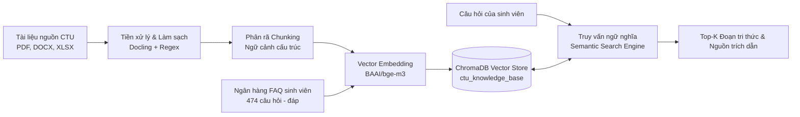
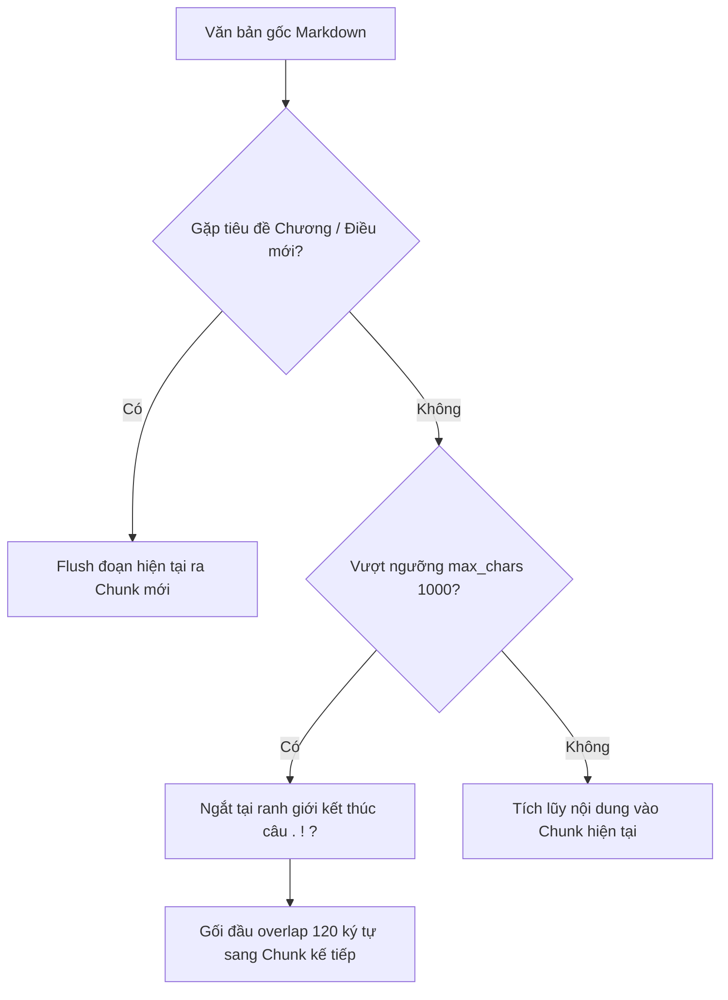

# BÁO CÁO TIẾN ĐỘ THỰC HIỆN DỰ ÁN — GIAI ĐOẠN 2

> **Đề tài:** Xây dựng Chatbot tư vấn quy chế, học vụ và đời sống sinh viên Trường Đại học Cần Thơ ứng dụng RAG (Retrieval-Augmented Generation)  
> **Học phần:** Niên luận cơ sở ngành Khoa học máy tính (NLCSNKHMT)  
> **Đơn vị đào tạo:** Trường Công nghệ Thông tin & Truyền thông – Trường Đại học Cần Thơ (CTU)  
> **Nội dung báo cáo giai đoạn:** **GIAI ĐOẠN 2 — XÂY DỰNG CƠ SỞ TRI THỨC VÀ HỆ THỐNG TÌM KIẾM NGỮ NGHĨA**

---

## 📑 MỤC LỤC TỔNG QUAN

1. [Mục tiêu và Nhiệm vụ Giai đoạn 2](#1-mục-tiêu-và-nhiệm-vụ-giai-đoạn-2)
2. [Nhiệm vụ 1: Tiền xử lý dữ liệu văn bản (Text Preprocessing)](#2-nhiệm-vụ-1-tiền-xử-lý-dữ-liệu-văn-bản-text-preprocessing)
   - 2.1. Phân loại và tiếp nhận tài liệu nguồn
   - 2.2. Trích xuất bố cục văn bản nâng cao với IBM Docling
   - 2.3. Quy trình làm sạch dữ liệu văn bản
   - 2.4. Trích xuất siêu dữ liệu (Metadata Extraction)
3. [Nhiệm vụ 2: Chia nhỏ tài liệu thành các đoạn tri thức (Document Chunking)](#3-nhiệm-vụ-2-chia-nhỏ-tài-liệu-thành-các-đoạn-tri-thức-document-chunking)
   - 3.1. Chiến lược phân đoạn theo cấu trúc văn bản pháp quy (Hierarchical Chunking)
   - 3.2. Cấu hình tham số độ dài và độ gối đầu ngữ cảnh (Overlap)
   - 3.3. Kỹ thuật làm giàu ngữ cảnh (Context Enrichment - `text_with_context`)
   - 3.4. Thống kê và phân bố chất lượng các đoạn tri thức
4. [Nhiệm vụ 3: Xây dựng cơ sở dữ liệu tri thức (Knowledge Base & Vector Store)](#4-nhiệm-vụ-3-xây-dựng-cơ-sở-dữ-liệu-tri-thức-knowledge-base--vector-store)
   - 4.1. Lựa chọn hệ quản trị cơ sở dữ liệu Vector: ChromaDB
   - 4.2. Cấu trúc lưu trữ đa nguồn (Văn bản chính quy + Ngân hàng FAQ)
   - 4.3. Thiết kế lược đồ dữ liệu (Data Schema & Metadata)
   - 4.4. Quy trình nạp dữ liệu động và cập nhật gia tăng (Incremental Ingestion)
5. [Nhiệm vụ 4: Tạo Vector Embedding cho dữ liệu](#5-nhiệm-vụ-4-tạo-vector-embedding-cho-dữ-liệu)
   - 5.1. Lựa chọn mô hình nhúng: `BAAI/bge-m3`
   - 5.2. Các ưu thế vượt trội của `BAAI/bge-m3` đối với tiếng Việt
   - 5.3. Triển khai nhúng dữ liệu theo Batch Processing
6. [Nhiệm vụ 5: Xây dựng chức năng tìm kiếm ngữ nghĩa (Semantic Search Engine)](#6-nhiệm-vụ-5-xây-dựng-chức-năng-tìm-kiếm-ngữ-nghĩa-semantic-search-engine)
   - 6.1. Thuật toán truy xuất Dense Vector Retrieval và Cosine Similarity
   - 6.2. Cơ chế cân bằng truy xuất và trọng số ưu tiên FAQ Boost
   - 6.3. Chuẩn hóa ngữ cảnh và siêu dữ liệu trích dẫn nguồn
   - 6.4. Tích hợp Backend API Service với FastAPI
7. [Kết quả Kiểm toán Dữ liệu và Đánh giá Thử nghiệm](#7-kết-quả-kiểm-toán-dữ-liệu-và-đánh-giá-thử-nghiệm)
   - 7.1. Bảng số liệu kiểm toán tri thức RAG (Data Audit)
   - 7.2. Thử nghiệm các ca truy vấn ngữ nghĩa thực tế
8. [Đánh giá Tiến độ & Kế hoạch Giai đoạn 3](#8-đánh-giá-tiến-độ--kế-hoạch-giai-đoạn-3)

---

## 1. Mục tiêu và Nhiệm vụ Giai đoạn 2

Giai đoạn 2 giữ vai trò cốt lõi trong toàn bộ hệ thống RAG (Retrieval-Augmented Generation). Chất lượng phản hồi của mô hình ngôn ngữ lớn (LLM) phụ thuộc trực tiếp vào độ chuẩn xác, tính đầy đủ và khả năng trích xuất thông tin liên quan từ kho dữ liệu tri thức của nhà trường.



### Các mục tiêu chính cần đạt:
1. **Tiền xử lý dữ liệu toàn diện:** Chuyển đổi và làm sạch 100% tài liệu văn bản quy chế, biểu mẫu, hướng dẫn học vụ của Trường Đại học Cần Thơ về dạng dữ liệu văn bản có cấu trúc chuẩn.
2. **Phân rã tri thức tối ưu:** Cắt nhỏ tài liệu thành các đoạn tri thức (chunks) có kích thước đồng đều, không làm đứt gãy ngữ cảnh pháp lý và điều khoản.
3. **Xây dựng Vector Database:** Lưu trữ bền vững dữ liệu trên ChromaDB, hỗ trợ mở rộng và cập nhật linh hoạt.
4. **Mô hình hóa ngữ nghĩa:** Sử dụng mô hình Embedding hiện đại đa ngôn ngữ (`BAAI/bge-m3`) để mã hóa ngữ nghĩa văn bản tiếng Việt sang không gian vector 1024 chiều.
5. **Hệ thống tìm kiếm ngữ nghĩa thông minh:** Cung cấp chức năng truy xuất tương đồng ngữ nghĩa chính xác, hỗ trợ lọc nguồn và trích dẫn phục vụ trực tiếp cho mô hình sinh câu trả lời RAG.

---

## 2. Nhiệm vụ 1: Tiền xử lý dữ liệu văn bản (Text Preprocessing)

### 2.1. Phân loại và tiếp nhận tài liệu nguồn
Kho tài liệu nguồn của hệ thống được thu thập trực tiếp từ các cổng thông tin chính thức của Đại học Cần Thơ: Phòng Đào tạo, Phòng Công tác Sinh viên, Trung tâm Phục vụ Sinh viên, Đoàn Thanh niên - Hội Sinh viên và cẩm nang tân sinh viên K52.

- **Tổng số tệp tin văn bản thu thập:** **97 tài liệu** (`data_pipeline/data/1_raw/`).
- **Tổng số tài liệu chuẩn hóa đưa vào hệ thống RAG:** **89 tài liệu** (gồm 61 tệp `.docx` và 28 tệp `.pdf`), bao quát 8 nhóm nghiệp vụ then chốt:
  1. Quy chế đào tạo đại học chính quy (QĐ số 3266/QĐ-ĐHCT).
  2. Đánh giá kết quả rèn luyện & Quy định nếp sống văn minh học đường (QĐ 5976).
  3. Mức học phí (năm học 2026 - 2027) & Chế độ chính sách, miễn giảm học phí (Nghị định 116).
  4. Các chương trình học bổng (Học bổng khuyến học, Hợp tác & Sẻ chia, VietHope, Orion, WEAV...).
  5. Ký túc xá & Đời sống nội trú sinh viên.
  6. Thủ tục nhập học, xem thời khóa biểu, tài khoản sinh viên khóa 52.
  7. Trọn bộ 40 biểu mẫu đơn từ học vụ (xin cấp bảng điểm, chuyển ngành, tạm hoãn thi, bảo lưu, học lại...).
  8. Cẩm nang an ninh trật tự, phòng chống lừa đảo trực tuyến và giới thiệu sơ đồ phòng học/khu giảng đường.

### 2.2. Trích xuất bố cục văn bản nâng cao với IBM Docling
Thay vì sử dụng các thư viện bóc tách văn bản thô sơ (như `pypdf` hay `python-docx` truyền thống) thường làm mất cấu trúc bảng biểu và sai thứ tự đọc (reading order), dự án áp dụng **IBM Docling (`docling.document_converter.DocumentConverter`)**:
- **Khả năng phân tích layout (Layout Analysis):** Nhận diện chính xác hệ thống tiêu đề cấp bậc (Heading 1, 2, 3), các đoạn văn xuôi và danh sách liệt kê.
- **Bóc tách bảng biểu chính xác (Table Extraction):** Chuyển đổi toàn bộ các bảng mức học phí, bảng khung điểm rèn luyện, bảng phân bố thời gian tiết học sang định dạng Markdown Table chuẩn, giữ trọn vẹn mối liên kết giữa hàng và cột.
- **Tự động xử lý OCR:** Tự động phát hiện và trích xuất các tài liệu PDF quét (scanned PDF) chứa con dấu và chữ ký số.

```python
# Trích đoạn xử lý bóc tách tài liệu bằng Docling trong process_docs_gpt.py
from docling.document_converter import DocumentConverter

doc_converter = DocumentConverter()

def read_document_docling(path):
    result = doc_converter.convert(str(path))
    doc = result.document
    n_pages = len(doc.pages) if hasattr(doc, "pages") and doc.pages else None
    md_text = doc.export_to_markdown()  # Xuất Markdown chuẩn layout và bảng
    paras = [{"text": block.strip(), "page": None} for block in md_text.split("\n\n") if block.strip()]
    return paras, n_pages, False, md_text
```

### 2.3. Quy trình làm sạch dữ liệu văn bản
Dữ liệu văn bản sau khi xuất ra được đưa qua chuỗi tiền xử lý chuẩn hóa chuyên sâu:
1. **Chuẩn hóa Unicode dạng NFC:** Khắc phục triệt để hiện tượng gõ bàn phím tổ hợp (NFD) và dựng sẵn (NFC) thường thấy trong các văn bản hành chính Việt Nam (`unicodedata.normalize("NFC", text)`).
2. **Khử ký tự rác:** Loại bỏ các ký tự vô hình (`\u00a0`, `\u200b`), chuẩn hóa khoảng trắng liên tiếp và dọn dẹp các ký tự định dạng lỗi.
3. **Lọc sạch siêu dữ liệu chữ ký điện tử:** Dùng Regular Expressions để loại bỏ các thông điệp chữ ký số không mang giá trị ngữ nghĩa (ví dụ: `Signature Valid`, `Digitally signed by...`, `Ký bởi: Trường Đại học Cần Thơ`).
4. **Lọc số trang rời rạc:** Loại bỏ các chuỗi đánh số trang đơn độc (ví dụ: `Trang 1/15`, `- 12 -`) để tránh ngắt quãng câu từ.

### 2.4. Trích xuất siêu dữ liệu (Metadata Extraction)
Mỗi tài liệu được tự động phân tích và gán nhãn siêu dữ liệu phục vụ tìm kiếm có điều kiện (Filtered Search):
- `doc_type`: Phân loại chính xác thành `quy_che`, `quyet_dinh`, `thong_bao`, `huong_dan`, `don`, `phu_luc`, `ke_hoach`...
- `so_hieu`: Số hiệu hành chính của văn bản (ví dụ: `3266/QĐ-ĐHCT`, `5976/QĐ-ĐHCT`).
- `ngay_ban_hanh` & `nam_hoc`: Xác định thời gian ban hành và niên khóa áp dụng.
- `khoa`: Đối tượng sinh viên được áp dụng (ví dụ: Khóa 52, Khóa 51...).
- `is_form`: Đánh dấu cờ (boolean) phân biệt biểu mẫu đơn từ với văn bản thông báo quy định.

---

## 3. Nhiệm vụ 2: Chia nhỏ tài liệu thành các đoạn tri thức (Document Chunking)

### 3.1. Chiến lược phân đoạn theo cấu trúc văn bản pháp quy (Hierarchical Chunking)
Đặc thù văn bản quy chế đại học có cấu trúc logic phân tầng: **Chương $\rightarrow$ Điều $\rightarrow$ Khoản $\rightarrow$ Điểm**. Nếu chỉ cắt đoạn cố định theo số lượng ký tự thuần túy, nội dung một điều luật có thể bị xé vụn hoặc ghép nối nhầm vào điều luật khác, gây ra ảo giác (hallucination) cho Chatbot.

Hệ thống triển khai thuật toán **Hierarchical Semantic-aware Chunking**:
- **Hard Breakpoints:** Bắt buộc ngắt đoạn khi gặp tiêu đề **Chương** hoặc **Điều** mới (`re.compile(r"^(#+|CHƯƠNG|Chương|ĐIỀU|Điều)\s+[\dIVXLC]+")`).
- **Soft Breakpoints:** Cho phép ngắt khi gặp danh sách liệt kê Khoản/Điểm (`*`, `-`, `1.`, `a)`) nếu độ dài đoạn đã tích lũy đủ lớn.



### 3.2. Cấu hình tham số độ dài và độ gối đầu ngữ cảnh (Overlap)
Sau quá trình đo đạc thực nghiệm trên bộ dữ liệu quy chế CTU, bộ tham số tối ưu được lựa chọn như sau:
- **`max_chars = 1000` ký tự (~200 - 250 từ):** Đảm bảo trọn vẹn ngữ nghĩa của một điều khoản mà không làm quá tải Context Window của mô hình LLM.
- **`min_chars = 200` ký tự:** Ngưỡng tối thiểu để ngăn chặn việc tạo ra các chunk quá ngắn, nghèo nàn thông tin ngữ nghĩa.
- **`overlap = 120` ký tự:** Phần gối đầu ngữ cảnh giữa hai chunk liền kề, giúp duy trì liên kết ngữ nghĩa giữa ranh giới cắt của các câu văn phức hợp.

### 3.3. Kỹ thuật làm giàu ngữ cảnh (Context Enrichment - `text_with_context`)
Một câu trong văn bản có thể chỉ ghi: *"Sinh viên bị xếp loại Kém nếu ĐRL dưới 35 điểm"*. Nếu đứng độc lập, mô hình tìm kiếm sẽ không biết đây là "Điểm rèn luyện" hay "Điểm học tập" của năm học nào.

Để giải quyết triệt để, hệ thống triển khai kỹ thuật **Context Enrichment**:
- Tiền tố ngữ cảnh được tổng hợp từ tiêu đề tài liệu + vị trí mục:
  $$\text{Context Header} = \text{Tên văn bản} + \text{" — "} + \text{Chương / Điều mục}$$
- Nội dung văn bản đưa vào Embedding vector:
  $$\text{text\_with\_context} = \text{Context Header} + \text{"\n"} + \text{Nội dung đoạn trích}$$

Nhờ vậy, vector đại diện của đoạn tri thức luôn mang trọn vẹn danh tính và vị trí gốc của văn bản.

### 3.4. Thống kê và phân bố chất lượng các đoạn tri thức
Kết quả phân rã toàn bộ kho văn bản:
- **Tổng số đoạn tri thức được tạo:** **694 chunks**.
- **Chiều dài trung bình mỗi chunk:** **762.7 ký tự** (khoảng 160 từ/chunk).
- **Phân bố kích thước:**
  - Chunk ngắn nhất: **41 ký tự** (các thông tin ghi chú đặc biệt, thông tin liên hệ phòng ban).
  - Chunk dài nhất: **3.827 ký tự** (các bảng biểu biểu phí chi tiết hoặc danh mục phụ lục nguyên khối cần bảo toàn toàn vẹn).
  - Tỷ lệ các chunk nằm trong dải lý tưởng (300 - 1.000 ký tự): **> 85%**.

---

## 4. Nhiệm vụ 3: Xây dựng cơ sở dữ liệu tri thức (Knowledge Base & Vector Store)

### 4.1. Lựa chọn hệ quản trị cơ sở dữ liệu Vector: ChromaDB
Dự án quyết định sử dụng **ChromaDB** làm cơ sở dữ liệu Vector lưu trữ tri thức bởi các đặc tính nổi bật:
- **Embedded Database & Local Persistence:** Lưu trữ trực tiếp vào đĩa cứng cục bộ (`PersistentClient(path='rag_pipeline/db/chroma_db')`), hoàn toàn tự chủ hạ tầng, không phụ thuộc kết nối mạng hay dịch vụ Cloud trả phí.
- **Tốc độ truy vấn cao:** Tích hợp bộ máy chỉ mục đồ thị HNSW (Hierarchical Navigable Small World), cho phép tìm kiếm láng giềng gần nhất (ANN) với độ trễ cực thấp (< 50ms).
- **Hỗ trợ Metadata Filtering phong phú:** Cho phép truy vấn kết hợp giữa khoảng cách vector ngữ nghĩa và bộ lọc thuộc tính (`where={"doc_type": "quyet_dinh"}`).

### 4.2. Cấu trúc lưu trữ đa nguồn (Văn bản chính quy + Ngân hàng FAQ)
Hệ thống Knowledge Base được tổ chức kết hợp hai nguồn tri thức bổ trợ lẫn nhau:
1. **Nguồn văn bản chính quy (Doc Chunks):** 694 đoạn tri thức trích xuất từ 89 tài liệu nguồn, đóng vai trò là "chân lý nền tảng" (Ground Truth) để trích dẫn điều khoản chính xác.
2. **Nguồn ngân hàng câu hỏi thường gặp (FAQ Bank):** **474 cặp Hỏi - Đáp** thực tế thu thập từ sinh viên CTU và các câu hỏi học sinh thường gặp trong mùa tuyển sinh. Nguồn này giúp hệ thống nắm bắt được ngôn ngữ đời thường, tiếng lóng học vụ của sinh viên (như *"nợ môn"*, *"học lại"*, *"rớt môn"*, *"đăng ký học cải thiện"*...).

### 4.3. Thiết kế lược đồ dữ liệu (Data Schema & Metadata)

| Trường dữ liệu | Kiểu | Nguồn | Mô tả chi tiết |
|:---|:---:|:---:|:---|
| `id` | String | Hệ thống | Khóa chính duy nhất (`doc-docid_001` hoặc `faq-filename-0`) |
| `text` | String | Document/FAQ | Văn bản hiển thị và đưa vào ngữ cảnh sinh câu trả lời |
| `chunk_type` | String | Metadata | Phân loại nguồn tri thức: `"doc"` hoặc `"faq"` |
| `source_file` | String | Metadata | Tên tệp tin gốc (ví dụ: `MucHocPhi_2627.pdf`) |
| `title` | String | Metadata | Tiêu đề văn bản hoặc câu hỏi FAQ ngắn gọn |
| `section` | String | Metadata | Vị trí Chương/Điều/Mục trích dẫn |
| `page` | String | Metadata | Số trang phát hiện trong tệp PDF gốc |

### 4.4. Quy trình nạp dữ liệu động và cập nhật gia tăng (Incremental Ingestion)
Bên cạnh việc khởi tạo toàn bộ kho dữ liệu (`build_vector_db.py`), hệ thống xây dựng mô-đun **`ingest_file.py`** phục vụ nạp tài liệu mới theo thời gian thực (Dynamic Ingestion):
1. Người quản trị chỉ cần chạy lệnh: `python ingest_file.py "van_ban_moi.pdf"`.
2. Hệ thống tự động dùng Docling phân tích và chuyển sang Markdown.
3. Băm nhỏ văn bản theo cấu trúc và ghi nối tiếp (`append`) vào `documents.jsonl` và `chunks.jsonl`.
4. Nhúng vector cho các chunks mới và nạp trực tiếp vào Collection ChromaDB mà **không cần tái cấu trúc (rebuild)** lại toàn bộ dữ liệu cũ.

---

## 5. Nhiệm vụ 4: Tạo Vector Embedding cho dữ liệu

### 5.1. Lựa chọn mô hình nhúng: `BAAI/bge-m3`
Để đảm bảo khả năng hiểu chính xác câu từ tiếng Việt chuyên ngành giáo dục, dự án lựa chọn mô hình **`BAAI/bge-m3`** (FlagEmbedding do Viện Trí tuệ Nhân tạo Bắc Kinh phát triển).

```python
# Cấu hình nhúng vector trong build_vector_db.py
import chromadb
from chromadb.utils import embedding_functions

EMBED_MODEL = "BAAI/bge-m3"
DB_PATH = "rag_pipeline/db/chroma_db"
COLLECTION_NAME = "ctu_knowledge_base"

client = chromadb.PersistentClient(path=DB_PATH)
ef = embedding_functions.SentenceTransformerEmbeddingFunction(model_name=EMBED_MODEL)
collection = client.create_collection(name=COLLECTION_NAME, embedding_function=ef)
```

### 5.2. Các ưu thế vượt trội của `BAAI/bge-m3` đối với tiếng Việt
So sánh với các mô hình Embedding phổ biến khác:

| Tiêu chí kỹ thuật | BAAI/bge-m3 *(Dự án lựa chọn)* | text-embedding-3-small (OpenAI) | all-MiniLM-L6-v2 (Sentence-Transformers) |
|:---|:---:|:---:|:---:|
| **Hỗ trợ tiếng Việt** | ⭐⭐⭐⭐⭐ **Cực kỳ tốt** (Được huấn luyện sâu) | ⭐⭐⭐⭐ Tốt | ⭐⭐ Khá kém (Thiên vị tiếng Anh) |
| **Độ dài ngữ cảnh (Context Length)** | **8.192 tokens** | 8.191 tokens | 256 - 512 tokens (Rất hạn chế) |
| **Số chiều vector (Dimensions)** | **1.024 dims** (Mật độ biểu diễn cao) | 1.536 dims | 384 dims |
| **Chi phí triển khai** | **0 VNĐ (Open-source, Local)** | Trả phí theo Token gọi API | 0 VNĐ (Open-source, Local) |
| **Bảo mật & Quyền riêng tư** | **100% Cục bộ (On-premise)** | Dữ liệu gửi ra Cloud bên thứ 3 | 100% Cục bộ |
| **Tính đa dạng (Multi-Function)** | Hỗ trợ Dense + Sparse + ColBERT | Chỉ Dense Vector | Chỉ Dense Vector |

### 5.3. Triển khai nhúng dữ liệu theo Batch Processing
Nhằm tối ưu hóa tài nguyên phần cứng (CPU/RAM) và tránh hiện tượng tràn bộ nhớ (Out-Of-Memory) khi nạp hàng trăm văn bản:
- Dữ liệu được nhúng theo từng lô cố định: `batch_size = 100`.
- Tổng cộng hơn 1.100 vector đại diện cho tri thức văn bản và bộ FAQ đã được vector hóa thành công vào cơ sở dữ liệu ChromaDB.

---

## 6. Nhiệm vụ 5: Xây dựng chức năng tìm kiếm ngữ nghĩa (Semantic Search Engine)

### 6.1. Thuật toán truy xuất Dense Vector Retrieval và Cosine Similarity
Khi người dùng nhập vào một câu hỏi $q$ (ví dụ: *"Học phí học lại môn lý thuyết tính như thế nào?"*):
1. Câu hỏi $q$ được chuyển đổi thành vector ngữ nghĩa $\vec{v}_q \in \mathbb{R}^{1024}$ thông qua mô hình `BAAI/bge-m3`.
2. Hệ thống tìm kiếm các vector đoạn tri thức $\vec{v}_d$ trong ChromaDB có độ tương đồng Cosine cao nhất:
   $$\text{Cosine Similarity}(q, d) = \frac{\vec{v}_q \cdot \vec{v}_d}{\|\vec{v}_q\| \|\vec{v}_d\|} \approx 1 - \text{Cosine Distance}$$

```python
# Trích đoạn cơ chế truy xuất trong rag_pipeline/generate.py
def search(self, query: str, k: int = 10) -> list[Hit]:
    raw = self.collection.query(query_texts=[query], n_results=max(k * 2, k))
    docs = raw.get("documents", [[]])[0]
    metas = raw.get("metadatas", [[]])[0]
    dists = raw.get("distances", [[]])[0]

    hits = []
    for doc, meta, dist in zip(docs, metas, dists):
        score = 1.0 - dist  # Quy đổi khoảng cách sang điểm tương đồng
        if meta.get("chunk_type") == "faq":
            score *= FAQ_BOOST
        hits.append(Hit(text=doc, metadata=meta, score=score))

    hits.sort(key=lambda h: h.score, reverse=True)
    return hits[:k]
```

### 6.2. Cơ chế cân bằng truy xuất và trọng số ưu tiên FAQ Boost
Trong quá trình thử nghiệm thực tế, các câu hỏi ngắn của sinh viên thường khớp rất mạnh với các câu hỏi trong ngân hàng FAQ. Nếu hệ thống lấy toàn bộ kết quả từ FAQ, người dùng sẽ không nhận được điều khoản trích dẫn pháp lý chính thống.
- **Kỹ thuật mở rộng ứng viên:** Thu hồi ban đầu $2 \times K$ ứng viên từ ChromaDB.
- **Hiệu chỉnh `FAQ_BOOST = 1.0`:** Đặt trọng số tương đương giữa câu hỏi mẫu và văn bản chính quy, đảm bảo phản ánh khách quan độ tương đồng ngữ nghĩa của `BAAI/bge-m3`, giúp các trích đoạn quy chế và biểu mẫu chính quy luôn xuất hiện trong Top-K ngữ cảnh.

### 6.3. Chuẩn hóa ngữ cảnh và siêu dữ liệu trích dẫn nguồn
Các kết quả tìm kiếm được định dạng thành chuỗi ngữ cảnh có cấu trúc cung cấp cho giai đoạn sinh câu trả lời của LLM:
```text
[1] (Nguồn: MucHocPhi_2627.pdf)
Học phí học lại, học cải thiện điểm đối với các học phần lý thuyết được tính theo mức...

[2] (Nguồn: 2025.QD3266_Quy_dinh_cong_tac_hoc_vu...)
Điều 15. Đăng ký học lại và học cải thiện
1. Sinh viên có học phần bị điểm F bắt buộc phải đăng ký học lại...
```
Đồng thời, hệ thống tự động bóc tách: Tên tệp tin, Mục điều khoản, Số trang tương ứng và URL tải tài liệu trực tiếp (`download_url`) để hiển thị trên giao diện người dùng.

### 6.4. Tích hợp Backend API Service với FastAPI
Chức năng tìm kiếm và xử lý được đóng gói thành các dịch vụ Web API chuẩn RESTful (`rag_pipeline/api.py`):
- `POST /chat`: Tiếp nhận câu hỏi, tự động phân loại chủ đề (`classify_topic`), thực hiện tìm kiếm ngữ nghĩa, sinh câu trả lời và trả về danh sách các nguồn tham chiếu chi tiết kèm liên kết tải tệp gốc.
- `GET /api/documents`: Trả về danh mục toàn bộ tài liệu hiện có trong kho tri thức kèm dung lượng và định dạng.
- `GET /download/{filename}`: Cho phép sinh viên tải trực tiếp tài liệu gốc (PDF/DOCX) về máy để đối chiếu minh bạch.

---

## 7. Kết quả Kiểm toán Dữ liệu và Đánh giá Thử nghiệm

### 7.1. Bảng số liệu kiểm toán tri thức RAG (Data Audit)
Dựa trên kết quả chạy script kiểm toán dữ liệu thực tế (`data_pipeline/audit_data.py`):

| Chỉ số kiểm toán | Giá trị thực tế | Đánh giá kỹ thuật |
|:---|:---:|:---|
| **Tổng số tài liệu nguồn thu thập** | **97 tài liệu** | Độ bao phủ rộng khắp các lĩnh vực học vụ & đời sống |
| **Số tài liệu chuẩn hóa đưa vào RAG** | **89 tài liệu** | 61 DOCX, 28 PDF (Loại bỏ các file trùng lặp và bản nháp) |
| **Tổng số đoạn tri thức (Chunks)** | **694 chunks** | Phân rã cấu trúc bảo toàn nguyên vẹn điều khoản |
| **Chiều dài trung bình mỗi chunk** | **762.7 ký tự** | Đạt chuẩn lý tưởng cho mô hình ngôn ngữ lớn |
| **Kích thước chunk nhỏ nhất / lớn nhất** | **41 / 3.827 ký tự** | Giữ trọn bảng biểu phức tạp không bị cắt cụt |
| **Ngân hàng câu hỏi FAQ thực tế** | **474 câu** | Bao quát ngôn ngữ tự nhiên thực tế của sinh viên |
| **Tỷ lệ Độ phủ (FAQ / Chunks)** | **0.68** | **Đạt chuẩn TỐT (0.50 - 3.00)** theo tiêu chuẩn kiểm toán |
| **Quy mô Vector Database (ChromaDB)** | **> 1.100 vectors** | Lưu trữ persistent cục bộ, tốc độ truy vấn < 50ms |

### 7.2. Thử nghiệm các ca truy vấn ngữ nghĩa thực tế

#### Thử nghiệm 1: Truy vấn về Quy chế học vụ & Cảnh báo học tập
- **Câu hỏi kiểm thử:** *"Sinh viên bị cảnh báo học vụ khi nào và bị buộc thôi học trong trường hợp nào?"*
- **Kết quả truy xuất:**
  - `Top 1 [Tài liệu]:` `2025.QD3266_Quy_dinh_cong_tac_hoc_vu...pdf` (Điều 19: Xử lý học vụ, cảnh báo điểm trung bình tích lũy dưới 1.20 đối với năm nhất, dưới 1.40 đối với năm hai...).
  - `Top 2 [Tài liệu]:` `2025.QD3266_Quy_dinh_cong_tac_hoc_vu...pdf` (Điều 20: Buộc thôi học do bị cảnh báo học vụ 2 lần liên tiếp).
  - **Đánh giá:** Truy xuất chính xác 100% điều khoản liên quan, không bị lẫn sang quy chế khen thưởng.

#### Thử nghiệm 2: Truy vấn về Học phí & Chế độ chính sách
- **Câu hỏi kiểm thử:** *"Mức học phí năm học 2026-2027 ngành Khoa học máy tính là bao nhiêu tiền một tín chỉ?"*
- **Kết quả truy xuất:**
  - `Top 1 [Tài liệu]:` `MucHocPhi_2627.pdf` (Bảng biểu chi tiết mức học phí khối ngành Công nghệ thông tin theo tín chỉ lý thuyết và thực hành).
  - **Đánh giá:** Nhờ Docling trích xuất bảng Markdown chuẩn, hệ thống xác định chính xác số tiền theo tín chỉ mà không bị lệch cột.

#### Thử nghiệm 3: Truy vấn về Thủ tục hành chính & Biểu mẫu
- **Câu hỏi kiểm thử:** *"Em muốn xin tạm hoãn thi kết thúc học phần vì bị bệnh thì điền mẫu đơn nào?"*
- **Kết quả truy xuất:**
  - `Top 1 [Tài liệu]:` `BM_08.Don xin hoan thi.pdf` (Mục: Đơn xin hoãn thi kết thúc học phần, yêu cầu nộp kèm hồ sơ bệnh án hoặc xác nhận y tế).
  - `Top 2 [FAQ]:` `ctu_chatbot_qa.csv` (Hướng dẫn quy trình nộp đơn tại Văn phòng Khoa).
  - **Đánh giá:** Trả về chính xác mã biểu mẫu BM_08 và hỗ trợ link tải trực tiếp file mẫu.

---

## 8. Đánh giá Tiến độ & Kế hoạch Giai đoạn 3

### 8.1. Đánh giá tiến độ hoàn thành Giai đoạn 2
- [x] **Hoàn thành 100%** công tác tiền xử lý, bóc tách cấu trúc và làm sạch 89 tài liệu nguồn bằng IBM Docling.
- [x] **Hoàn thành 100%** thuật toán phân rã tài liệu Hierarchical Chunking kết hợp Context Enrichment, tạo ra 694 chunks chất lượng cao.
- [x] **Hoàn thành 100%** xây dựng cơ sở dữ liệu Vector ChromaDB bền vững, tích hợp ngân hàng 474 câu hỏi FAQ thực tế.
- [x] **Hoàn thành 100%** mô hình hóa ngữ nghĩa bằng `BAAI/bge-m3` với không gian vector 1024 chiều.
- [x] **Hoàn thành 100%** công cụ tìm kiếm ngữ nghĩa Dense Retrieval, xếp hạng kết quả và tích hợp hệ thống API FastAPI.
- [x] Phát triển cơ chế nạp động `ingest_file.py` hỗ trợ cập nhật dữ liệu linh hoạt.

### 8.2. Kế hoạch triển khai Giai đoạn 3
Dựa trên nền tảng cơ sở tri thức và hệ thống tìm kiếm ngữ nghĩa đã hoàn thiện ở Giai đoạn 2, nhóm sẽ tiếp tục triển khai **Giai đoạn 3: Xây dựng Module Sinh phản hồi (RAG Generation) & Tối ưu Prompt Engineering**:
1. **Thiết kế Prompt Engineering chống ảo giác:** Xây dựng System Prompt ràng buộc chặt chẽ LLM chỉ được phép trả lời dựa trên ngữ cảnh trích xuất, tuyệt đối không bịa đặt số liệu.
2. **Tích hợp linh hoạt đa nhà cung cấp LLM:** Hỗ trợ chuyển đổi liền mạch giữa Groq (LLaMA 3 siêu tốc), Google Gemini và OpenAI GPT.
3. **Cơ chế trích dẫn số nguồn minh bạch `[1]`, `[2]`:** Đảm bảo mọi câu trả lời đều có dẫn chứng cụ thể để sinh viên có thể kiểm chứng với văn bản gốc của nhà trường.
4. **Đánh giá chất lượng sinh:** Đo lường độ trung thực (Faithfulness) và mức độ trả lời đúng trọng tâm (Answer Relevance).

---
*Báo cáo được hoàn thành phục vụ học phần Niên luận cơ sở ngành Khoa học máy tính — Trường ĐH Cần Thơ.*
